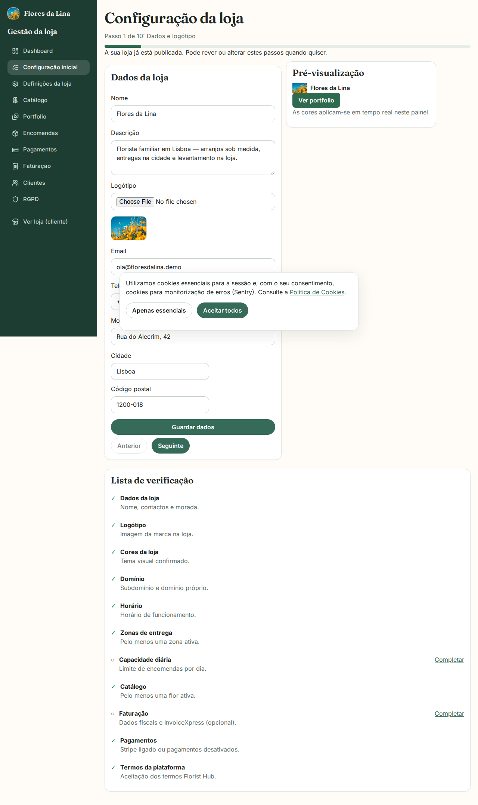
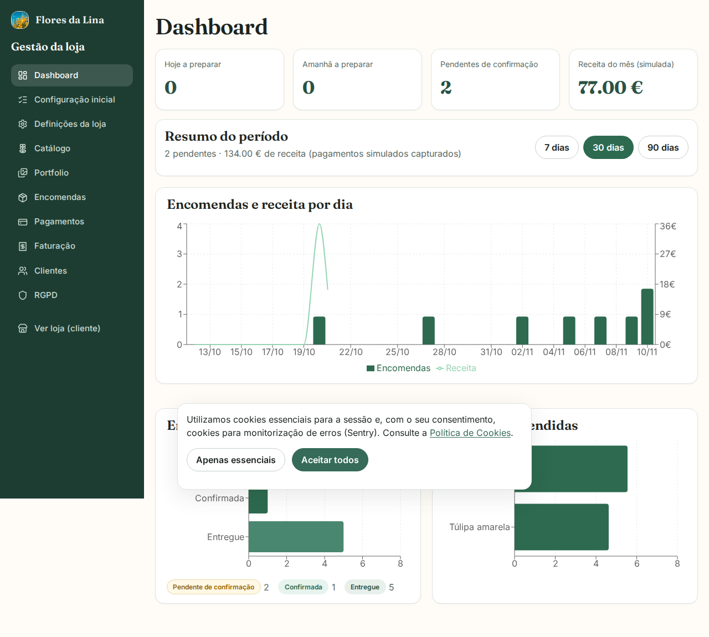
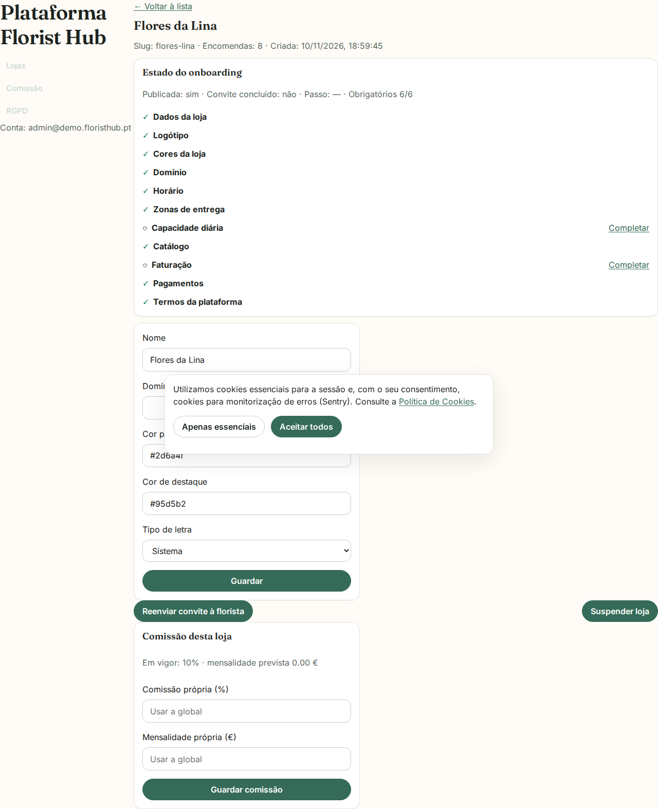

# Onboarding da florista

Fluxo para uma loja nova passar de convite por email à publicação com checkout (ou pagamentos desativados de propósito).

## Papéis e caminhos

1. **SuperAdmin** — `POST /api/platform/tenants` cria a loja (não publicada) e envia convite Resend (`FloristInviteService`). Em desenvolvimento (`Email__Provider=Log`), o link também aparece na resposta da API.
2. **Florista** — Abre o link `/convite?userId=…&token=…`, define a palavra-passe e entra no assistente web `/admin/configuracao-inicial` (passos memorizados em `Tenant.OnboardingWizardStep`).
3. **Publicação** — `POST /api/florist/onboarding/publish` só funciona quando os obrigatórios estão completos (ver lista abaixo).

## Passos do assistente (web)

| Ordem | Chave | Conteúdo |
|------|-------|----------|
| 1 | `loja` | Nome, descrição, logótipo, contactos, morada |
| 2 | `cores` | Cores com pré-visualização ao vivo; confirmação grava `OnboardingColorsAcknowledged` |
| 3 | `dominio` | Subdomínio (slug) e instruções CNAME para domínio próprio |
| 4 | `contactos-horario` | Atalho para definições (horário) |
| 5 | `entrega` | Zonas de entrega |
| 6 | `capacidade` | Limite diário + janelas (`DeliveryCapacityPolicy`); opcional |
| 7 | `catalogo` | Pelo menos uma flor ativa |
| 8 | `fiscal` | InvoiceXpress opcional |
| 9 | `pagamentos` | Stripe Connect ou desativar pagamentos |
| 10 | `termos` | Aceitação dos termos da plataforma |

Pode interromper e retomar: o passo actual fica em `PUT /api/florist/onboarding/wizard-step`.

## Lista de verificação (obrigatórios para publicar)

- Dados da loja (nome, email, telefone, morada completa)
- Cores confirmadas
- Pelo menos uma flor no catálogo
- Pelo menos uma zona de entrega ativa
- Termos da plataforma aceites
- Stripe com cobranças activas **ou** `PaymentsDisabledByChoice`

Até publicar, o catálogo público (`GET /api/flowers`), portfolio activo e novas encomendas de clientes respondem «loja ainda não está publicada».

## Convites

- Validade **72 h** (Identity `TokenLifespan` + registo `FloristInvites`).
- **Uso único**: ao concluir `POST /api/auth/florist-invite/complete`, o convite activo fica com `UsedAt`.
- **Reenvio**: `POST /api/platform/tenants/{id}/resend-invite` revoga convites anteriores, actualiza o carimbo de segurança e emite novo token.

## API (florista)

| Método | Caminho |
|--------|---------|
| GET | `/api/florist/onboarding` |
| PUT | `/api/florist/onboarding/wizard-step` |
| POST | `/api/florist/onboarding/acknowledge-colors` |
| PUT | `/api/florist/onboarding/daily-capacity` |
| PUT | `/api/florist/onboarding/payments-disabled` |
| POST | `/api/florist/onboarding/accept-platform-terms` |
| POST | `/api/florist/onboarding/publish` |

SuperAdmin: `GET /api/platform/tenants/{id}/onboarding`.

## App móvel

O ecrã **Preparação da loja** (a partir do dashboard da florista) mostra a mesma lista e permite publicar quando `canPublish` é verdadeiro.

## Capturas

