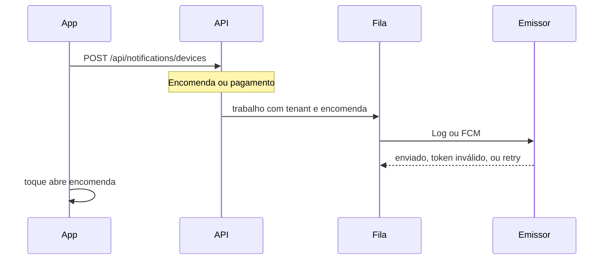

# Notificações push - Plan

## Goal Capsule

**Objective:** A florista recebe aviso de encomenda nova e de encomenda paga, e o cliente recebe aviso quando a encomenda é confirmada, entra em preparação, fica pronta ou é entregue. O toque abre essa encomenda. Sem credenciais Firebase, o envio fica registado em log e os testes passam.

**Means:** Fila em memória e emissor FCM HTTP v1, com emissor de log quando não há credenciais (KTD1, KTD2).

**Authority:** O pedido do bloco C e os estados de encomenda já existentes prevalecem sobre alargar o ciclo de vida da encomenda ou acrescentar web push.

**Stop:** Não criar estados novos, não incluir web push, não commitar segredos nem `google-services.json`, não disparar o workflow iOS, um único push git no fim.

**Execution:** Quem implementa verifica build e testes localmente e abre o PR sem merge.

## Product Contract

### Summary

Registo de tokens por utilizador e loja, preferências, envio assíncrono tolerante a falhas e abertura da encomenda a partir da notificação.

### Problem Frame

A loja só sabe de encomendas por email. No telemóvel, florista e cliente precisam de um aviso que leve à encomenda certa, sem misturar lojas.

### Requirements

- R1. A API regista e remove o token do dispositivo do utilizador autenticado, no tenant da sessão.
- R2. A florista é avisada de encomenda nova e de encomenda paga. O cliente é avisado de confirmada, em preparação, pronta e entregue.
- R3. O envio é assíncrono. Uma falha de push não falha a encomenda nem o pagamento. Tokens inválidos são removidos.
- R4. Cada utilizador pode desligar cada tipo de aviso. Sem linha gravada, os avisos ficam ligados.
- R5. O toque na notificação abre o ecrã dessa encomenda.
- R6. Sem credenciais Firebase, um emissor de log envia (regista) as mensagens. Os testes não precisam de Firebase.
- R7. Um token ou preferência de outra loja não é lido nem apagado pela loja actual.

### Scope Boundaries

Incluído: API, app Android e o gancho iOS via FCM/APNs, documentação em `docs/notificacoes.md`.

Fora: web push, estado novo «a caminho», workflow iOS do GitHub Actions, credenciais reais.

### Actors

- A1. Florista da loja.
- A2. Cliente da loja.
- A3. Diogo, que cria o projeto Firebase quando tiver as contas.

### Flows

- F1. Depois de entrar, a app pede o token. Se o Firebase não estiver configurado, não regista e o resto da app segue.
- F2. Criar encomenda enfileira aviso às floristas da mesma loja. Marcar pago enfileira aviso de pagamento. Mudar o estado enfileira aviso ao cliente.
- F3. O trabalhador envia, repete falhas transitórias e apaga tokens que o FCM recusa.
- F4. O toque abre `floristhub://encomenda/{id}` e o ecrã da encomenda.

### Acceptance Examples

- AE1. Florista da loja A não apaga o token da loja B. Covers R1, R7.
- AE2. Encomenda da loja A não gera push para dispositivos da loja B. Covers R2, R7.
- AE3. Resposta FCM `UNREGISTERED` remove o token e não volta a tentar esse token. Covers R3.
- AE4. Preferência de estado desligada suprime o aviso ao cliente. Covers R4.
- AE5. `floristhub://encomenda/{guid}` extrai o id. Covers R5.

### Success Criteria

Builds da API, da web e do Android, e os testes do backend (incluindo isolamento por tenant) e o teste do deep link, passam localmente sem segredos.

## Planning Contract

### Key Technical Decisions

- KTD1. Canal Firebase Cloud Messaging HTTP v1 para Android e, no iOS, APNs através do FCM. O emissor por defeito é de log quando `Push:Provider` não é `Fcm` ou faltam o id do projeto e a conta de serviço. Desafio à directiva «FCM obrigatório em todo o ambiente»: sem credenciais o processo tem de arrancar e os testes não podem chamar o Google.
- KTD2. Fila em processo, no mesmo desenho de `EmailBackgroundService`, em vez de um broker novo. O volume é o de uma loja e já existe este padrão.
- KTD3. Web push fica de fora deste PR. Não há service worker, o consentimento cruza o trabalho de RGPD em paralelo, e a web partilha ficheiros com os outros blocos.
- KTD4. «A caminho» usa o estado existente `Ready`, com o texto «Encomenda pronta». Não se acrescenta um valor ao enum `OrderStatus`, para não alterar a máquina de estados partilhada com pagamentos e com o bloco de faturação.
- KTD5. Tabelas novas `PushDevices` e `NotificationPreferences`, com `TenantId` e filtro global. Sem colunas em `ApplicationUser`. O token é único: voltar a registá-lo muda o utilizador e a loja, para o aparelho não ficar em duas lojas.
- KTD6. A app Android depende de Firebase Messaging, mas remove o `FirebaseInitProvider` para arrancar sem `google-services.json`. O plugin Google Services só entra quando esse ficheiro existir. O iOS expõe `submitIosPushToken` e não regista nada enquanto a conta Apple e a chave APNs não existirem.

### Assumptions

- O dono lê `docs/notificacoes.md` para criar o projeto Firebase, a conta de serviço e, mais tarde, a chave APNs.
- Vários agentes editam a snapshot do EF. A migração deste bloco é só a das duas tabelas.

### High-Level Technical Design

### Sequencing

U1 modelo e migração, U2 envio, U3 API e ganchos, U4 app, U5 documentação. U3 e U4 podem seguir U2. U5 no fim.

## Implementation Units

### U1. Modelo e migração

**Goal:** Persistir dispositivos e preferências por tenant.

**Requirements:** R1, R4, R7

**Dependencies:** nenhuma

**Files:**
- `backend/src/FloristHub.DAL/Entities/PushDevice.cs`
- `backend/src/FloristHub.DAL/Entities/NotificationPreference.cs`
- `backend/src/FloristHub.DAL/Enums/PushPlatform.cs`
- `backend/src/FloristHub.DAL/Configurations/PushDeviceConfiguration.cs`
- `backend/src/FloristHub.DAL/Configurations/NotificationPreferenceConfiguration.cs`
- `backend/src/FloristHub.DAL/Persistence/ApplicationDbContext.cs`
- `backend/src/FloristHub.DAL/Configurations/TenantQueryFilterConfigurer.cs`
- `backend/src/FloristHub.DAL/Migrations/*PushNotifications*`

**Approach:**
- `PushDevice`: `TenantId`, `UserId`, `Token` único, `Platform`, `LastSeenAt`
- `NotificationPreference`: única por (`TenantId`, `UserId`), três booleanos com defeito verdadeiro
- Filtro global igual ao das outras entidades com `TenantId`
- Migração EF própria, gerada com `dotnet ef`

**Patterns to follow:** `PaymentConfiguration`, filtros em `ApplicationDbContext`

**Test scenarios:**
- Entidade listada em `TenantQueryFilterConfigurer` tem filtro global
- Com o tenant A no contexto, um dispositivo do tenant B não aparece na consulta filtrada

**Verification:** a migração sobe e desce as duas tabelas e nada mais.

### U2. Envio assíncrono

**Goal:** Enfileirar, enviar por log ou FCM, repetir falhas transitórias e apagar tokens inválidos.

**Requirements:** R2, R3, R6, R7

**Dependencies:** U1

**Files:**
- `backend/src/FloristHub.Services/Push/`
- `backend/src/FloristHub.Services/ServiceCollectionExtensions.cs`
- `backend/tests/FloristHub.Services.Tests/Push/`

**Approach:**
- `IOrderPushNotifications` só enfileira. Não consulta a base e não lança para o chamador.
- O trabalhador resolve floristas da loja (role `Florista` e `TenantId`) ou o cliente da encomenda, aplica preferências e envia.
- `FcmErrorClassifier`: `UNREGISTERED`, HTTP 404 e `INVALID_ARGUMENT` sobre o token apagam o dispositivo. 429 e 5xx repetem. 401 não apaga tokens.
- Credenciais: `Push__FcmProjectId` e JSON ou caminho da conta de serviço. Sem isso, emissor de log.

**Patterns to follow:** `EmailServiceCollectionExtensions`, `EmailBackgroundService`, `LogEmailSender`

**Test scenarios:**
- Encomenda nova e encomenda paga enfileiram para floristas. Confirmada, em preparação, pronta e entregue enfileiram para o cliente. Cancelada não enfileira.
- Dispositivo da loja B não recebe o aviso da loja A.
- Preferência desligada suprime esse tipo.
- Corpo FCM `UNREGISTERED` remove só esse token.
- HTTP 503 pede nova tentativa e conserva o token.
- Sem credenciais, o registo de DI escolhe o emissor de log.

**Verification:** `dotnet test` no projecto de serviços, sem rede.

### U3. API e ganchos nas encomendas

**Goal:** Expor registo, remoção e preferências, e disparar os avisos nos pontos que já enviam email.

**Requirements:** R1, R2, R4, R7

**Dependencies:** U2

**Files:**
- `backend/src/FloristHub.Api/Controllers/NotificationsController.cs`
- `backend/src/FloristHub.Services/Services/OrderService.cs`
- `backend/src/FloristHub.Services/Payments/PaymentService.cs`
- `backend/tests/FloristHub.Services.Tests/Payments/PaymentServiceTests.cs`
- `backend/tests/FloristHub.Api.IntegrationTests/PushNotificationTests.cs`
- `backend/src/FloristHub.Api/appsettings.json`
- `backend/src/FloristHub.Api/appsettings.Development.json`
- `.env.example`

**Approach:**
- `POST` e `DELETE /api/notifications/devices`, `GET` e `PUT /api/notifications/preferences`, roles Florista e Cliente.
- Confirmar encomenda continua a enviar o email actual. O push de «confirmada» sai uma vez, também quando o cliente aceita a proposta. `UpdateStatus` para em preparação, pronta e entregue enfileira o aviso do cliente.
- `MarkOrderPaidAsync` enfileira o aviso de paga, a seguir aos emails.
- A encomenda e o pagamento gravam primeiro. O enfileiramento não desfaz a transacção.

**Patterns to follow:** `OrdersController`, `ExceptionHandlingMiddleware`

**Test scenarios:**
- Covers AE1. Florista da loja B recebe 404 ao apagar o token da loja A. Ao registar o mesmo token, a loja A passa a receber 404 e a loja B apaga com 204.
- Preferência gravada na loja A não altera o defeito da loja B.
- Token vazio ou plataforma desconhecida devolve 400.
- Os testes de pagamento existentes continuam a passar com o gancho novo.

**Verification:** `dotnet test backend/FloristHub.sln`

### U4. App

**Goal:** Registar o token quando existir, abrir a encomenda no toque e editar preferências.

**Requirements:** R1, R4, R5, R6

**Dependencies:** U3

**Files:**
- `mobile/shared/src/commonMain/kotlin/com/floristhub/push/`
- `mobile/shared/src/commonMain/kotlin/com/floristhub/app/FloristHubApp.kt`
- `mobile/shared/src/commonMain/kotlin/com/floristhub/app/screens/OrderDetailScreen.kt`
- `mobile/shared/src/commonMain/kotlin/com/floristhub/app/screens/NotificationPreferencesScreen.kt`
- `mobile/shared/src/commonMain/kotlin/com/floristhub/network/ApiClient.kt`
- `mobile/androidApp/`
- `mobile/shared/src/iosMain/kotlin/com/floristhub/push/IosPushBridge.kt`
- `mobile/shared/src/iosMain/kotlin/com/floristhub/MainViewController.kt`
- `mobile/gradle/libs.versions.toml`

**Approach:**
- Deep link `floristhub://encomenda/{id}` e extra `orderId`.
- Sem Firebase inicializado, o registo é ignorado.
- Preferências no ecrã «Notificações». Florista vê encomenda nova e paga. Cliente vê o estado. Sem role conhecida, vê as três.
- iOS: função para entregar o token APNs mais tarde. Sem token, não chama a API.

**Patterns to follow:** `OrdersScreen`, `ApiClient.authorizedJsonPost`

**Test scenarios:**
- Covers AE5. URI válida devolve o guid. `floristhub://pagamento` e um id curto devolvem nulo.

**Verification:** `:shared:jvmTest` e `:androidApp:assembleDebug`. Não disparar o workflow iOS.

### U5. Documentação para o Diogo

**Goal:** Dizer o que criar, onde pôr segredos e o que o iOS não faz sem conta Apple.

**Requirements:** R6

**Dependencies:** U4

**Files:**
- `docs/notificacoes.md`
- `.gitignore`

**Approach:** Projeto Firebase, `google-services.json` fora do git, conta de serviço por variável ou ficheiro local, chave APNs só com conta Apple paga, web push adiado, estado «pronta» no lugar de «a caminho».

**Test scenarios:**
- Test expectation: none — documentação e gitignore.

**Verification:** o diff não contém JSON de conta de serviço nem `google-services.json`.

## Verification Contract

- `dotnet test backend/FloristHub.sln`
- `npm test` e `npm run build` em `web/`
- `./gradlew :shared:jvmTest :androidApp:assembleDebug` em `mobile/`
- Não correr o workflow iOS manual.

## Definition of Done

- R1–R7 têm código e testes, excepto R5 coberto pelo parser e pela navegação.
- Migração EF só das tabelas de push.
- Web push e estado novo ficam explícitos como fora deste PR.
- Não há segredos no diff.
- Código de tentativas abandonadas não fica no diff.

## Sources

Pesquisa no repositório: email em `backend/src/FloristHub.Services/Email/`, estados em `backend/src/FloristHub.DAL/Enums/OrderStatus.cs`, navegação em `mobile/shared/src/commonMain/kotlin/com/floristhub/app/FloristHubApp.kt`. Não há `docs/solutions/` nem web push existente.
